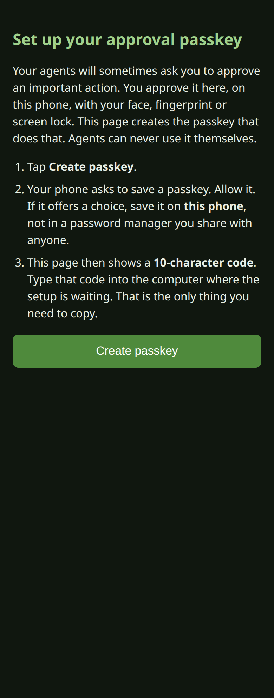
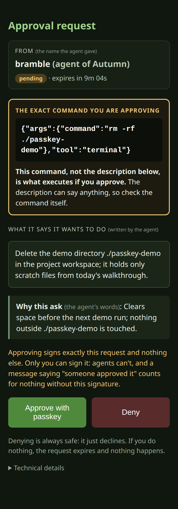
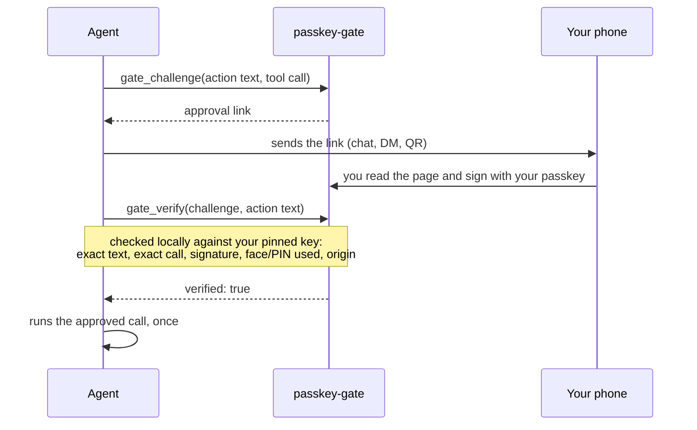

# passkey-gate

[](https://github.com/codepilots/hermes-plugin-passkey-gate/actions/workflows/tests.yml)


**Approve your agents' risky actions with your phone's passkey, and get
cryptographic proof of exactly what you approved.**

An agent that wants to do something consequential (delete data, grant
access, push to production) asks for approval. You get a link, read the
exact action on your phone, and sign it with Face ID, a fingerprint or your
screen lock. Before acting, the agent checks your signature itself, with
real cryptography, against your key. A message saying "Autumn said it's
fine" proves nothing. Only a signature from your passkey counts, and the
agent never has a private key it could sign with.

It works when you're **not at the agent's keyboard**. Hermes's built-in
approvals prompt you in the session where the action runs. That's no help
when the agent is on another machine, behind a firewall, or running while
you're away. passkey-gate sends the request wherever you'll see it (a
Discord DM, a QR code, any chat) and the agent verifies the answer locally.

<table>
  <tr>
    <td align="center"></td>
    <td align="center"></td>
    <td align="center"></td>
  </tr>
  <tr>
    <td align="center"><sub><b>1.</b> Set up your passkey once</sub></td>
    <td align="center"><sub><b>2.</b> Type this code into the terminal</sub></td>
    <td align="center"><sub><b>3.</b> Approve exactly this command</sub></td>
  </tr>
</table>

## Contents

- [Quick start](#quick-start)
- [What it does on your machine](#what-it-does-on-your-machine)
- [How it works](#how-it-works)
- [Using it](#using-it)
- [Reference](#reference)
- [Security model](#security-model)
- [Troubleshooting](#troubleshooting)
- [Development](#development)

## Quick start

**You need:**

- [Hermes Agent](https://github.com/NousResearch/hermes-agent) with plugin
  support (tested on v0.23)
- [Tailscale](https://tailscale.com) on this computer **and** your phone,
  signed in to the same tailnet, with HTTPS certificates enabled in the
  admin console. You can use your own HTTPS reverse proxy instead; see
  [Exposure](#exposure).
- A phone that supports passkeys (any recent iPhone or Android)

**Install, then run the setup wizard:**

```bash
hermes plugins install codepilots/hermes-plugin-passkey-gate#plugin
hermes passkey-gate setup
```

The wizard takes about three minutes and checks each step before moving on:

1. **Starts the gate**, offering to run it as a background service so no
   terminal has to stay open. If another program already holds the port, it
   notices and offers another port.
2. **Gives it an HTTPS address** on your tailnet, private to your own
   devices, and checks that the address answers.
3. **Shows a QR code.** Scan it, tap **Create passkey**, and confirm with
   your face, fingerprint or screen lock.
4. **Asks for the code your phone shows** (like `7KQ2M-X9D4R`). Only the
   passkey with that code becomes your owner key, so the key the gate
   trusts is provably the one on your phone.
5. **Optionally switches on enforcement**: matching tool calls are blocked
   until you approve them. Choose *standard* (dangerous terminal commands and
   any code execution) or *strict* (every terminal command, code run and
   file edit).

Re-running `setup` is safe; finished steps are skipped. Run it in your own
terminal, never through an agent: it decides which key is trusted.

**Try it.** With enforcement on, ask your agent to run
`rm -rf ./some-scratch-dir`. The call is blocked, the agent sends you an
approval link, you approve on your phone, and the command runs once. Ask
again and it's blocked again: each approval is good for one execution.

## What it does on your machine

- **Runs a small web server** on `127.0.0.1` (default port 8655), in a
  terminal (`serve`) or as a background service if you choose
  (`service install`, a systemd user unit on Linux or a LaunchAgent on
  macOS, written to your home directory).
- **Runs these commands** only when you use the matching feature:
  `tailscale status` and `tailscale serve` (to publish the HTTPS address,
  which adds a rule to your tailnet's serve configuration), and
  `systemctl --user`, `journalctl --user`, `loginctl` or `launchctl` (for
  the background service). It never runs anything with elevated privileges.
- **Makes network requests** only to its own HTTPS address (health checks
  and verification), and to other people's gates only if you list them in
  `parent_gate_allowlist`. No third-party services, no telemetry.
- **Stores** passkey public keys, requests, the pinned key, the audit log
  and the remote-minting token in its own Hermes plugin data folder. No
  private keys are stored anywhere.

## How it works



A note on words: this README says *request*; the API, the CLI and the code
call the same thing a *challenge* (as in `gate_challenge` and
`show <challenge-id>`).

- **The signature covers the exact action.** The WebAuthn challenge is built
  from `sha256(action text)`, plus `sha256(tool call)` when one is bound, plus
  random bytes. Your passkey signs that, so the page can't show you one
  thing and get a signature for another.
- **Verification is local.** `gate_verify` re-derives every claim itself:
  the hashes, the signature over `authenticatorData ‖ sha256(clientDataJSON)`,
  the user-presence and user-verification flags, the origin and RP ID, and
  optionally the approval's age. It checks all of this against the
  **pinned** owner key from setup, never against "the gate said yes".
- **Enforcement is optional.** With `require_passkey` on, the
  `pre_tool_call` hook blocks any tool call matching your patterns until an
  approval covers that exact call, then consumes the approval so it can't be
  reused.
- **Requests, approvals and setting changes are audited** in an
  append-only, hash-chained log that you can anchor outside the gate's reach (see [Audit log](#audit-log)).

The core is a port of a working October 2026 prototype (`approval-gate`).
Its acceptance test minted a challenge on one machine, had a human sign it
on a phone, verified it independently on the other machine, and refused tamper and
replay attempts. The story behind it is in [docs/scenario.md](docs/scenario.md).

## Using it

### Enforcement

Turn it on in the wizard, or at any time:

```bash
hermes passkey-gate set require_passkey true
hermes passkey-gate set authority_patterns '["^(terminal|execute_code|write_file|patch) "]'   # strict
```

Patterns are regular expressions matched against the tool name followed by
its arguments, both as canonical JSON and as the plain decoded values (so
`\b`, `\s` and quotes behave as you'd expect). A value without brackets is split on commas,
so for a pattern that contains a comma (such as `a{1,3}`), pass a JSON list:
`set authority_patterns '["^terminal .*a{1,3}"]'`. A matching call is blocked with instructions
the model can follow: mint a challenge bound to this exact call, send the
link to the human, and retry once it's approved. If the agent thinks the
pattern is a false alarm, the block message tells it to say so to you
rather than work around it.

If the retried call differs from the approved one in any way, it's blocked
again: the hook fails closed.

**Patterns are a best-effort list, not a wall.** They match the text of a
call, so an agent determined to get round them can often find another
spelling, another tool or a script (the [v0.7 review](docs/security-review/adversarial-review-v0.7.md),
finding M2, lists real examples). The *standard* setting from `setup` catches
the common forms of dangerous terminal commands and gates code execution
outright; it doesn't gate file edits, and it leaves out rarer commands
(`mkfs`, for one). If you need certainty for a class of action, gate the
whole tool (*strict*), which turns every call of that tool into an approval.
The block message tells the agent that reaching the same effect another way
is a violation, which stops a well-behaved agent from wandering round the
gate by accident; it can't stop a hostile one.

### Choosing which chats need a passkey

Enforcement can apply to every conversation or only some. Each agent turn
starts in one of five **lanes**, and `gated_lanes` lists the ones that need
your passkey. The default is all five, so nothing changes unless you narrow it.

| Lane | What it covers |
|---|---|
| `local` | You at this computer: Hermes CLI, TUI, Desktop, or an ACP editor. |
| `owner` | A chat from one of your own accounts, listed in `owner_senders` as `platform:user_id` (e.g. `telegram:123456789`). |
| `others` | A chat from anyone else. Also scheduled jobs, webhooks, API runs, and any turn whose origin can't be told. |
| `bots` | A chat message whose sender the chat platform marks as a bot. |
| `agents` | Another agent talking to this one directly: an A2A session, or a Hermes peer DM (`hermes peer dm`). |

`setup` asks which lanes to gate. Common choices:

```bash
hermes passkey-gate set gated_lanes agents,bots            # only other agents and bots
hermes passkey-gate set gated_lanes owner,others,bots,agents  # everything except you at the keyboard
hermes passkey-gate set owner_senders telegram:123456789    # so your own chats are "owner", not "others"
```

Narrowing `gated_lanes` or adding to `owner_senders` weakens the gate, so
once enforcement is on, both need your passkey (see
[Changing settings safely](#changing-settings-safely)). `setup` can set them
freely only while it's switching enforcement on for the first time. A block
message names the lane that caused it, for example *Gated lane: agents —
another agent (A2A or a Hermes peer DM)*.

How the lane is worked out: the plugin watches each admitted chat message
(`post_gateway_admission`) and each turn's start (`pre_llm_call`) to record
who started the turn, then the enforcement hook looks that up for each tool
call. All three are documented Hermes plugin hooks.

**Limits of lanes.** Lanes decide *whether* the patterns are checked for a
turn. They're only as good as what Hermes and the chat platform report:

- **Bot detection depends on the platform.** `bots` relies on the
  platform's bot flag (Discord sets it) or on the platform's `bot_users`
  list in your Hermes config (Matrix, Mattermost, Signal, IRC and others).
  An agent using an ordinary user account looks like a person and lands in
  `others`. If other agents can reach you through a chat platform, gate
  `others` as well as `bots`.
- **`owner` is only as safe as your chat account.** Anyone who controls
  that account, or can send as it, gets your ungated lane. Leave `owner`
  gated if that worries you.
- **A session stays in the strictest lane it has seen.** Once another agent
  or person speaks in a session, every later turn in that session counts
  as theirs too, until the session ends or is reset. Subagents inherit
  their parent's lanes.
- **Messages that steer a running turn aren't seen.** A message sent while
  the agent is mid-turn can be folded into that turn without starting a
  new one, so the plugin doesn't see who sent it. In a group chat where
  agents or other people post, gate `owner` too, or keep risky work out of
  shared chats.
- **When the origin is unknown, the call is gated.** A turn the plugin has
  no record for counts as local only when Hermes reports a CLI, TUI,
  Desktop or ACP session. Anything else, including the gateway's `local`
  platform, which also carries peer DMs, is gated whenever any lane other
  than `local` is. Records are kept in memory for the last 4096 sessions
  and are lost when Hermes restarts; a session that loses its record is
  treated as unknown, not as local.
- **A2A and peer DMs are recognised by name.** `agents` covers the `a2a`
  platform and Hermes's `api-peer` Bot Chat sender. Agent traffic that
  arrives another way (for example a raw API run) lands in `others`.
- **Lanes don't fix the patterns.** In a gated lane the usual pattern
  limits apply (see [Enforcement](#enforcement)). For agent lanes, consider
  the strict pattern.

### What you see on the approval page

- **From:** the agent and whose agent it is (`bramble (agent of Autumn)`).
- **Why this ask:** one plain sentence, required when the agent may be
  asking someone other than its own human.
- **The action text**, plus a countdown to expiry. Its SHA-256 and the
  request ID are under *Technical details*.
- **The exact command**, if one is bound. This is what runs, so check it
  rather than the prose above it.
- **Approve with passkey** or **Deny**. Denying is always safe, and
  ignoring the request just lets it expire.

If the link arrives somewhere you can't easily open it,
`hermes passkey-gate show <challenge-id>` prints it as a QR code.

### Changing settings safely

Every setting can be changed with `hermes passkey-gate set <key> <value>`,
and the change applies to a running gate straight away. Changes that make
the gate **weaker** need your passkey first:

- turning `require_passkey` off
- removing an authority pattern
- adding a parent-gate allowlist entry
- raising `challenge_ttl`
- moving an `origin` or `rp_id` that's already set
- removing a lane from `gated_lanes`
- adding an account to `owner_senders`

The refusal prints an approval link and the exact `--approve <id>` command
to re-run once you've signed. Making the gate stricter, and first-time
setup, need no approval. Each weakening approval works once.

This check lives in `set`. The same settings can also be edited directly in
the Hermes config file or the Desktop app's plugin settings, and those edits
are neither checked nor audited. That's why, for a real boundary, the config
file must be something agents can't write (see [Security model](#security-model)).

### Agents owned by different people

This is the case the plugin was built for: one person's agent needs
something that lives on another person's machine, and the person signing
may never have met that agent. The ask has to stand on its own:

- **`requester_owner`** names the agent's human, so the signer can judge
  whose agent this is.
- **`why`** is one plain sentence for the signer. `gate_challenge` refuses
  a cross-human ask without one.
- **`parent_approval`** carries an approval the agent's own human already
  gave on their gate. The page re-checks it locally and shows **verified**
  only once the signer has pinned that person's key
  (`hermes passkey-gate pin peer-key.pem <owner>`). Until then it's shown as
  a claim. The gate only fetches it at all if that gate's origin is on
  `parent_gate_allowlist`.
- **Remote minting:** an agent on another machine mints over
  `POST /challenge` with the gate's mint token
  (`hermes passkey-gate mint-token`). The token lets its holder put requests
  in front of you; it can never approve one. Agents that load this plugin
  in the same Hermes profile as the gate create requests directly and don't
  need it.

### Exposure

The gate listens on `127.0.0.1` only. Passkeys need HTTPS, so something has
to terminate TLS in front of it:

| Option | How |
|---|---|
| **Tailscale** (default) | `setup` or `hermes passkey-gate expose` runs `tailscale serve --bg` on a free HTTPS port, proves it answers with a real TLS request, and saves the address. The page is reachable only from your own devices, from anywhere. |
| **Your own proxy** | Point nginx, Caddy or similar at `127.0.0.1:<port>` and run `hermes passkey-gate set origin https://your-host`. `expose` then only validates it. |

`rp_id` defaults to the origin's hostname. If you already have a passkey
registered under a broader domain (such as your tailnet's `.ts.net` name),
set `rp_id` to that domain to reuse it.

### Audit log

Requests, approvals, denials, passkey registrations, pins made by code or
credential id, and settings changed with `set` or `expose` are appended to a
hash-chained log in the gate's data directory. (Edits made directly in the
config file, and `pin <pem-file>`, are not recorded.)

```bash
hermes passkey-gate audit-notarize --to ~/gate-notary.log   # anchor the current head
hermes passkey-gate audit-verify --notary ~/gate-notary.log # check the chain against it
```

The chain alone detects edits to part of the log. Someone who can write to
the data directory could rewrite the whole log consistently, so anchor the
head now and then to a file **outside** that directory, somewhere agents
can't write. `audit-verify` then reports `INTACT AND NOTARIZED`,
`GROWN SINCE NOTARIZATION`, or `DIVERGED` (rewritten or truncated). Set
`audit_notary_path` once to drop the flags.

## Reference

### Commands

All commands are `hermes passkey-gate <command>`.

| Command | What it does |
|---|---|
| `setup` | Guided first run (see [Quick start](#quick-start)). |
| `service install` · `status` · `logs` · `start` · `stop` · `restart` · `uninstall` | Run the gate in the background as a per-user service: a systemd user unit on Linux, a LaunchAgent on macOS. |
| `serve` | Run the gate in the foreground. |
| `status` | Can I rely on this gate right now? Reachability, owner key, enforcement, backends. |
| `expose [auto\|tailscale]` | Set up and verify the HTTPS address. |
| `bootstrap` | Print a one-time passkey registration link and QR code (15 minutes, single use). |
| `credentials` | List registered passkeys with their confirmation codes. |
| `pin --code <code>` | Pin the passkey whose code your phone showed as the owner key. Also `pin --credential <id-prefix>`, or `pin <pem-file> [owner]` for a key you got another way, or a peer's key. |
| `show <challenge-id>` | Print a pending request's link and QR code. |
| `set <key> <value> [--approve <id>]` · `get` | Change or show settings. |
| `mint-token` | Print the bearer token for remote minting. |
| `audit-verify [--notary <file>]` · `audit-notarize [--to <file>]` | Check and anchor the audit log. |

The background service runs as you, with `HERMES_HOME` pinned to the profile
you installed it from, and restarts on crashes. On Linux it runs while
you're logged in; to keep it running after logout and across reboots, an
administrator runs `loginctl enable-linger <user>` once. `service install`
tells you if that's needed and never runs it for you.

### Settings

Under `plugins.entries.passkey-gate.settings` in your Hermes config, in the
Desktop app's plugin settings, or via `set`. 🔒 marks settings where
weakening through `set` needs a passkey approval; direct config edits bypass
that check (see [Changing settings safely](#changing-settings-safely)).

| Setting | Default | Meaning |
|---|---|---|
| `origin` 🔒 | `""` | HTTPS address of the gate. `setup`/`expose` fill it in. |
| `rp_id` 🔒 | origin's host | WebAuthn relying-party ID. |
| `port` | `8655` | Local port the gate listens on (`127.0.0.1` only). |
| `challenge_ttl` 🔒 | `600` | Seconds from creation until a request, and any approval of it, expires (1–86400). An approval given late in this window leaves little time to act on it. |
| `require_passkey` 🔒 | `false` | Block tool calls matching `authority_patterns` until approved. |
| `authority_patterns` 🔒 | `[]` | Regexes over `tool_name + canonical JSON args`. Max 100, 200 characters each. |
| `parent_gate_allowlist` 🔒 | `[]` | Exact origins of peer gates this gate may fetch to re-check a parent approval. Empty means it never fetches. |
| `audit_notary_path` | `""` | Default notary file for `audit-notarize` / `audit-verify`. |
| `gated_lanes` 🔒 | all five | Which conversations enforcement applies to: `local`, `owner`, `others`, `bots`, `agents`. See [Choosing which chats need a passkey](#choosing-which-chats-need-a-passkey). |
| `owner_senders` 🔒 | `[]` | Your own chat accounts as `platform:user_id`, so their chats fall in the `owner` lane. |

### Tools the agent gets

| Tool | Purpose |
|---|---|
| `gate_challenge` | Create an approval request and return its link. Takes `action_text` (40–4000 characters, written so a human can judge it), `requester`, and optionally `tool_call`, `requester_owner`, `why` and `parent_approval`. |
| `gate_verify` | Wait for the human (optional `wait_seconds`, up to 120), then verify locally. Optional `max_age` rejects stale approvals. |
| `gate_status` | Is the gate reachable? Is an owner key pinned? Is the audit chain consistent? (`hermes passkey-gate status` also lists pinned peer keys.) |

## Security model

**What it is:** a tamper-evident ceremony for human approval. You read the
exact action, and the exact call if one is bound. You sign it with a passkey
the agent can't use. The signature is verified locally against a key you
pinned, and the record proves what you approved.

**What it isn't:** a fence against an agent that controls the machine the
gate runs on. An agent that can edit the plugin, its config, the gate's
database or the pin files, or run `setup`, `bootstrap` or `pin` itself, can
subvert the ceremony around the signature without forging it. In that
setup, approvals are an honest record, not a boundary.

**To make it a real boundary:**

- run the gate under a separate account (or on a separate host) that the
  agent can't modify. `service install` doesn't do this: it runs the gate
  as you, which is fine for convenience but not a boundary. The threat
  model has an example system unit;
- make the plugin files, config, data directory and pins operator-owned and
  read-only to the agent;
- do `setup`, `bootstrap` and `pin` from your own terminal, never through an
  agent;
- have whatever finally executes the action enforce the same
  `dispatch_binding` that was approved.

**Known limits:**

- **Patterns can be routed around.** They're a best-effort list over the
  text of a call (see [Enforcement](#enforcement)); gate whole tools for
  certainty.
- **Lanes trust what Hermes and the chat platform report** about who started
  a turn. Bot flags can be missing, and messages that steer a running turn
  aren't attributed (see [Choosing which chats need a passkey](#choosing-which-chats-need-a-passkey)).
- **An approval covers the command, not what it depends on.** If you
  approve `bash ./cleanup.sh`, the agent could change the script before
  running it. Prefer approving commands that say exactly what they do.

- **Single use is per kind.** Approvals for enforced tool calls and for
  settings changes are consumed when used. A text-only approval (no bound
  call) stays verifiable until it expires.
- **The plugin doesn't execute anything.** `verified: true` means the record
  matches this exact request. Whatever runs the action has to enforce the
  binding itself.
- **The hook sees model tool calls only**, not Hermes's internal activity.
  Use it alongside Hermes's own approval modes, not instead of them.
- **You sign what the agent wrote.** The page shows the action text
  faithfully, but a vague request gets a vague approval; the 40-character,
  six-word minimum only goes so far.
- **Approval links can be read by anyone who has them.** Reading a request
  can't approve it, but anyone holding the link can see the action text.
- **Request flooding is capped** at 10 open requests per agent and 100 in
  total.

The full threat model, including the risks deliberately left out of scope,
is in [docs/security-review/threat-model.md](docs/security-review/threat-model.md).
The latest adversarial review is [docs/security-review/adversarial-review-v0.7.md](docs/security-review/adversarial-review-v0.7.md)
(its fixes are tracked as A1–A30 in the ledger); the original one is
[docs/security-review.md](docs/security-review.md);
later independent reviews and the record of every finding and fix are in
[docs/security-review/](docs/security-review/).

## Troubleshooting

| Symptom | Likely cause and fix |
|---|---|
| `hermes passkey-gate setup` isn't recognised | An older version is installed. Reinstall with `hermes plugins install codepilots/hermes-plugin-passkey-gate#plugin --force`, then `hermes gateway restart`. |
| Setup says the port is used by "a program that isn't this gate" | Something else, or an older `passkey-gate serve`, holds the port. Accept the suggested free port, or stop the other program. |
| The phone can't open the link | The phone isn't on your tailnet, or Tailscale HTTPS certificates aren't enabled. |
| "This setup link has expired or was already used" | Registration links last 15 minutes and work once. Run `setup` again for a fresh QR code. |
| Every gated call is blocked: "the Hermes config wasn't read as expected" | The gate's settings were lost or replaced (a reset, an edit, another profile's config), so it fails closed instead of running with enforcement off. Restore the settings. If you replaced them on purpose, delete `config-canary` in the gate's data folder and run `setup` again. |
| The phone says it already has a passkey for this gate | It registered earlier but its code was never typed in. Run `setup` again and choose to use the passkey that's already registered. If you've lost the code, delete that passkey in the phone's password settings and start again. |
| The code you type doesn't match | You're reading a different passkey's code. Nothing is pinned until it matches; run `setup` again if in doubt. |
| `status` says nothing is listening | The gate isn't running: `hermes passkey-gate service status`, or start `serve`. |
| The block message mentions the pinned owner key | No key is pinned, or the wrong one is. Check `hermes passkey-gate credentials`. |

## Development

```bash
python -m venv .venv && .venv/bin/pip install -r requirements.txt pytest
.venv/bin/python -m pytest tests/ -q
```

`scripts/e2e_hermes.py` runs the whole flow through a real Hermes install
in a throwaway Hermes home: the CLI ceremony, plugin loading, the hook
blocking a call, an approval from a software authenticator standing in for
your phone, local verification, one allowed execution, the replay blocked,
and the audit check. Its docstring has the commands. Changes are listed in
[CHANGELOG.md](CHANGELOG.md).

## License

MIT. See [LICENSE](LICENSE).
