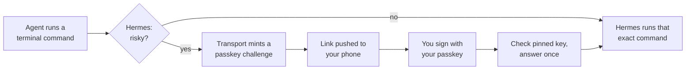
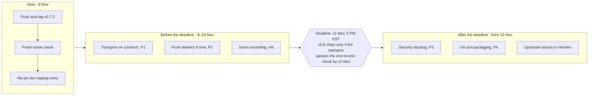

# passkey-gate: improvement proposal

8 November 2026 · Autumn Thomson

*Local copy of the proposal doc
([claude.ai](https://claude.ai/artifact/UhTCsQa8ydQak5tDPRW32X)); the two
diagrams are redrawn here in Mermaid.*

## Summary

Ship v0.7.2 now, then make passkey-gate a Hermes **approval transport** so Hermes decides what needs approval and the passkey proves the human said yes. That one change replaces the weakest part of the plugin (operator-written regex patterns) with Hermes's own dangerous-command detection, and binds each approval to one live request.

Before the hackathon deadline (5 PM EST, 11 November 2026): release v0.7.2, and build the transport on a branch only if it can pass the end-to-end check by 10 November; otherwise present it as the roadmap. After the deadline: push delivery of approval links, the rest of the security backlog, and three small asks to the Hermes project.

## Where things stand

v0.7.2 is committed (not yet pushed) and fixes the six most serious findings of the v0.7 adversarial review; the cryptographic core held up under every attack tried.

| Area | State in v0.7.2 |
| --- | --- |
| Signature, nonce binding, single use, expiry | Sound: no reviewer found a way to approve without the pinned passkey |
| H1 setup could pin a squatter's key | Fixed |
| M3 hook could fail open | Fixed, confirmed in real Hermes |
| M1 a tool-call approval could weaken settings | Fixed |
| M4 settings approvals could be replayed | Fixed, confirmed in real Hermes |
| M5 settings phrase hid the change | Fixed |
| M2 enforcement patterns easy to evade | Mitigated: broader default, strict mode, honest docs |
| M8 approval covers text, not what it depends on | Documented only |
| 16 LOW and 5 INFO items (A7–A30) | Queued, three partly done |

**The main remaining weakness is M2.** Patterns written by the operator are a deny-list over the text of a tool call, and an agent determined to avoid approval can often find another spelling, flag order, tool or script. Strict mode (gate whole tools) is certain but asks the human to approve every call. Proposal 1 is the fix.

## Proposal 1: passkey-gate as a Hermes approval transport

Register passkey-gate as a Hermes approval transport, so Hermes's own dangerous-command detection (about 126 rules with Unicode normalisation and shell parsing) decides what needs approval, and the passkey signature is the proof. This is how the ntfy-approval plugin works, with a push button in place of a signature.

The detector, not the operator's regex, decides; the passkey only proves the human said yes to this one request. No answer, a deny or a timeout: Hermes blocks the command.

**Design**

- Call `ctx.register_approval_transport("passkey", present)` in `register()`, alongside the existing `pre_tool_call` hook. It is a documented, public Hermes API (Hermes v0.23), so it passes catalog rule 9.
- `present(request)` mints a challenge over Hermes's description and command, bound to the request's id and digest; delivers the link (Proposal 2); waits; verifies the signature against the pinned key; consumes it; and answers `once`. An explicit deny answers `deny`; a timeout raises, so silence isn't recorded as a refusal.
- Never answer `session` or `always`: either would let later commands in that category run unsigned.
- A `post_approval_response` hook expires the challenge when Hermes stops waiting (`/stop`, Ctrl-C, timeout).
- Refuse if the Hermes home differs from the one at registration (a known Hermes issue runs transports outside their profile).

**What it fixes:** M2 for terminal commands (Hermes catches `rm -fr`, `find -delete` and many more, and maintains the list), and part of M8: each approval is single-shot and tied to one live Hermes request, so there is no reuse window.

**What it doesn't cover**

- File edits, plugin tools and plugin-escalated calls: Hermes doesn't route those through a transport, so the `pre_tool_call` hook stays for them.
- Exfiltration verbs: Hermes asks about pipe-to-shell and credential uploads, not plain `curl` or `scp`.
- Hermes's smart mode (the default) lets a guardian model approve first, and yolo, `approvals.mode: off`, containers and unattended runs skip transports. The operator must set `approvals.mode: manual`.
- The passkey signs Hermes's redacted display text, not the raw command, so two commands differing only in a redacted secret look identical.

**Effort:** M, about a day including tests and an end-to-end check. Cross-human approvals and `gate_verify` for remote agents are unaffected.

## Proposal 2: push the approval link to the phone

Add optional push delivery, so the approval link reaches the human without relying on the agent to send it. A transport (Proposal 1) needs this: it has no way back into the chat. Today the agent must paste the link into a message, and an agent that wants to avoid approval simply doesn't.

**Design**

- An ntfy notification (self-hosted or ntfy.sh) per request, with an **Open** action that goes to the approval page. Standard library only, no redirects, responses capped at 64 KiB, in the style of ntfy-approval's client.
- Lock-screen text: a short title naming the profile, Hermes's reason or the action text clipped to a few hundred bytes, the request lifetime, and "No answer means deny". A `send_command: false` switch keeps the command off the lock screen.
- Withdraw the notification on every device when the request ends (approved, denied, expired or stopped), and mark the page expired.
- Topic and token stored as Hermes secrets in the profile's `.env`, never in a notification.

**Why it's safe here when it isn't for ntfy-approval:** an ntfy topic is a bearer secret, so in ntfy-approval anyone who can read it can approve. In passkey-gate the notification carries only a link, and reading the page can't approve: a leaked topic exposes the action text, not approval power. The README should still say so, because the action text may be sensitive.

**Effort:** M, about half a day. Fixes reliance on the agent to deliver the link, and makes the away-from-keyboard flow one tap.

## Proposal 3: finish the security backlog

Close the two remaining MEDIUM findings first (M7 terminal escapes, M6 audit flooding), then work through the LOW items in five groups; most are small, contained changes with a test each. IDs refer to the [remediation ledger](../security-review/remediation.md).

| Priority | Group | Items | What to do | Effort |
| --- | --- | --- | --- | --- |
| 1 | Spoofing the human | A8 (M7), A15 | Reject control, bidi and zero-width characters in requester, owner, why and action text; escape them in `show`; label agent-supplied fields as claimed; show the bound command above the prose | S |
| 2 | Flooding and availability | A7 (M6), A11, A12, A13, A27 | Stop auditing unauthenticated junk; cache the audit head instead of re-reading the log; rate-limit POSTs; give approval pages their own budget; a whole-request deadline; key quotas on a caller the agent doesn't choose | M |
| 3 | Address hardening | A14, A20, A21 | Refuse unknown `Host` headers (DNS rebinding); block all non-global addresses in peer fetches, including 100.64.0.0/10; cap fetch sizes with an overall deadline | S |
| 4 | Settings and canary edges | A16, A17, A18, A25, A29 | Check the canary before applying any settings; judge `rp_id` against the effective value; an upgrade note and a warning when the canary isn't armed; reload on a timer if file-stamping fails; lock canary arming | S |
| 5 | Ceremony and robustness | A19, A22–A24, A26, A28, A30 | Reject control characters in service paths; refuse ambiguous codes on the existing-passkey path; deny returns 409; regex timeout in the hook; recheck token expiry; no-follow file writes; tolerate a torn audit line; require `tool_call` to be an object | S |

A9 (M8, approvals covering text rather than what it depends on) stays documented; Proposal 1 narrows it, and a page warning for commands that run scripts or read variables would help further.

## Proposal 4: UX and packaging

Five small changes make the plugin easier to trust and to try; most are under an hour each.

- **`hermes passkey-gate test`:** sends a sample request to the phone, waits for a signature, and reports where it failed (address, phone, passkey) with a hint. Nothing runs. Copied from ntfy-approval, which uses it to build setup confidence.
- **A disclosure-first catalog description:** lead with one plain "Disclosure" sentence, as ntfy-approval does: it listens on a local port exposed over HTTPS, who can read and who can approve a request, what it stores, the background service it can install, that patterns are best effort, and that any failure blocks. Catalog rule 13 asks for this; ours currently leads with the pitch.
- **A readable `status`:** today it prints JSON. Lead with plain lines (gate reachable, key pinned, config check, enforcement mode), with `--json` for scripts.
- **Timeout guidance:** away from the keyboard, five minutes is short. Recommend a longer request lifetime and, with Proposal 1, a longer Hermes `approvals.timeout`.
- **Settle the minimum Hermes version:** the catalog says `>=0.21.5`, but the plugin has only been proven on v0.23, and v0.6.0 broke on an API difference. Raise the floor to `>=0.23` unless 0.21.5 is tested.

The demo recording for the README (ledger item H9) is the one open item that needs the human.

## Upstream asks for Hermes

Three small requests to the Hermes project would close gaps no plugin can close alone; each is a short issue to file, and acceptance is uncertain.

| Ask | Why it matters | What it would close |
| --- | --- | --- |
| Route plugin-escalated tool calls and file-write approvals through the selected approval transport | Today only terminal commands and some code execution reach a transport; a code comment calls the exclusion "parity with the historical gate" | The hook's own escalations and file edits could be passkey-approved through one path |
| Give transports the tool name and a hash of the raw command, not only the redacted display text | The passkey can only sign what the transport receives | The signature would cover exactly what runs, not a redacted rendering |
| A public "did the config fail to load?" call for plugins | The config canary covers lost settings, but if `config.yaml` won't parse and there's no last-known-good copy, Hermes doesn't load the plugin at all | A fail-closed signal Hermes itself can act on, without plugins reading internals |

A fourth, already known upstream: transports run on a thread that loses the active profile (hermes-agent #114580); ntfy-approval works around it, and Proposal 1 would too.

## Plan, effort and risks

Release v0.7.2 first, so the fixes are safe whatever happens next; the transport is the only change worth attempting before the deadline, and only behind a go/no-go check on 10 November.

If the transport isn't solid by 10 November, the submission ships v0.7.2 and describes Proposals 1 and 2 as the roadmap.

| Risk | Mitigation |
| --- | --- |
| The transport takes longer than a day | Keep it on a branch; v0.7.2 is already released and safe |
| Hermes defaults (smart mode, yolo, containers, unattended runs) skip transports | Require `approvals.mode: manual`; have `status` warn when it isn't set |
| Signing redacted display text confuses reviewers | Show the same redacted text on the approval page; file the upstream ask |
| New code trips the install scanner, as `mkfs` and a `sudo` hint did | Rescan before every commit; keep the pinned-install check in each release |
| Push through public ntfy.sh leaks action text | Recommend self-hosting or `send_command: false`; disclose it in the README |
