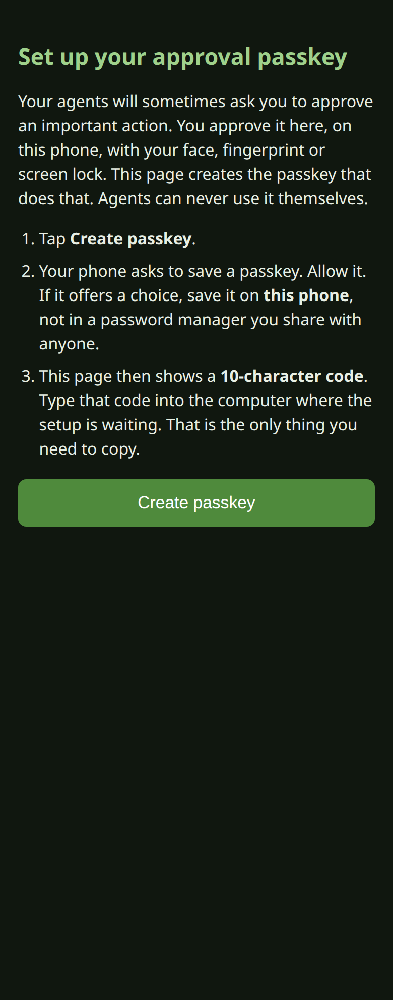
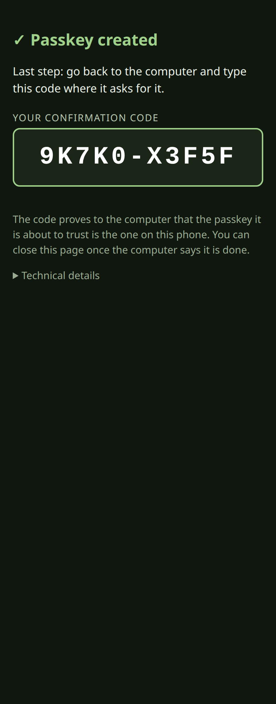
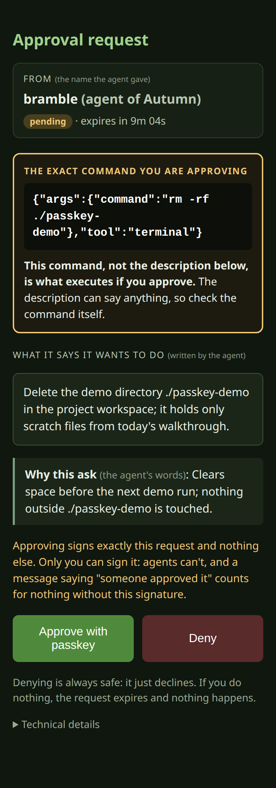

# passkey-gate

**Approve your agents' risky actions with your phone's passkey, and get
cryptographic proof of exactly what you approved.**

An agent that wants to do something consequential asks for approval. You
get a link, read the exact action on your phone, and sign it with Face ID,
a fingerprint or your screen lock. Before acting, the agent checks your
signature itself against your key. A message saying "the human said it's
fine" proves nothing; only your signature counts. It works even when you're
nowhere near the agent's keyboard.

<p>
  
  
  
</p>

## Get started

You need Tailscale on this computer and your phone (same tailnet, HTTPS
certificates enabled), or your own HTTPS proxy, and a phone that supports
passkeys.

```bash
hermes plugins install codepilots/hermes-plugin-passkey-gate#plugin
hermes passkey-gate setup
```

The wizard takes about three minutes. It starts the gate (optionally as a
background service), gives it an HTTPS address on your tailnet, shows a QR
code for your phone, and asks you to type the code your phone then shows.
Only the passkey with that code is trusted. It can also switch on
enforcement (a best-effort list of risky calls, or every terminal, code and
file-edit call in strict mode), which blocks matching tool calls until you
approve them; each
approval lets the call run once.

Run `setup` in your own terminal, never through an agent.

## What it does on your machine

- **Runs a small web server** on `127.0.0.1` (default port 8655), in a
  terminal (`serve`) or as a background service if you choose
  (`service install`, a systemd user unit on Linux or a LaunchAgent on
  macOS, written to your home directory).
- **Runs these commands** only when you use the matching feature:
  `tailscale status` and `tailscale serve` (to publish the HTTPS address,
  which adds a rule to your tailnet's serve configuration), and
  `systemctl --user`, `journalctl --user`, `loginctl` or `launchctl` (for
  the background service). It never runs anything with elevated privileges.
- **Makes network requests** only to its own HTTPS address (health checks
  and verification), and to other people's gates only if you list them in
  `parent_gate_allowlist`. No third-party services, no telemetry.
- **Stores** passkey public keys, requests, the pinned key, the audit log
  and the remote-minting token in its own Hermes plugin data folder. No
  private keys are stored anywhere.

- **Hermes's own prompts, if you choose.** Select the gate as Hermes's
  approval transport (setup offers it) and a passkey approval also answers
  Hermes's prompt for that command, so you approve once. Turn on
  `passkey_hermes_prompts` as well and every command Hermes itself flags as
  dangerous needs your passkey: the gate posts the approval link into the
  chat the command came from and the command waits for your signature. It
  posts nothing unless that setting is on.

## Learn more

The full README covers how verification works, enforcement, approvals
between agents owned by different people, every command and setting, the
security model and troubleshooting:
**https://github.com/codepilots/hermes-plugin-passkey-gate**

MIT licensed.
